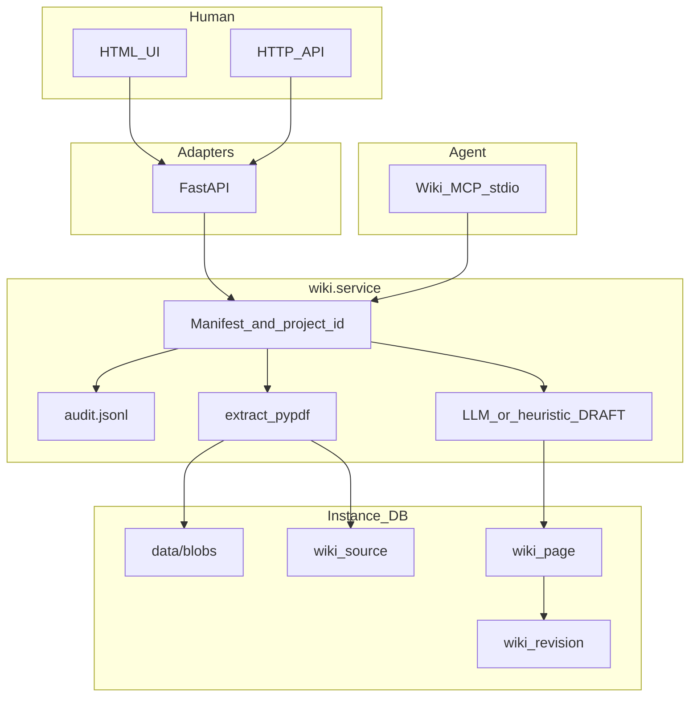
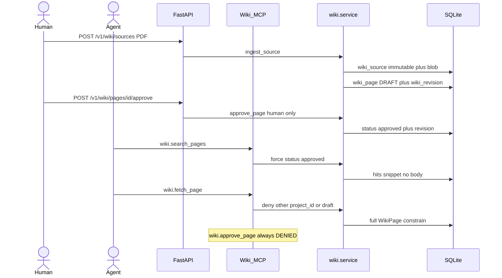

# Wiki Knowledge MVP

Local learning build of **UAPDF-WKM-001**. Not production Factory. No Knowledge Graph, no vector DB. LLM may **sort DRAFT** only — never paraphrase extract.

## Run (Makefile only)

```bash
cd mvp
make          # venv + install
cp .env.example .env   # optional: set WIKI_LLM_API_KEY for LLM sort
make seed     # 4 PDFs → DRAFT pages (heuristic unless .env has key + WIKI_SORT=auto|llm)
make run      # http://127.0.0.1:8000
```

In the UI: approve drafts, search approved.

```bash
make seed-approve   # skip UI; pages already approved
make test
make mcp            # stdio MCP, same SQLite
make clean          # wipe DB/blobs; keep venv
```

## LLM sort (optional)

Gate: OpenAI-compatible `https://llm-gate.imespro.ai/v1` (see `.env.example`).

| Env | Default | Meaning |
|---|---|---|
| `WIKI_SORT` | `auto` | `heuristic` \| `llm` \| `auto` (llm if `WIKI_LLM_API_KEY` set) |
| `WIKI_LLM_BASE_URL` | `https://llm-gate.imespro.ai/v1` | chat completions base |
| `WIKI_LLM_API_KEY` | _(empty)_ | Bearer — put in `mvp/.env` only (gitignored) |
| `WIKI_LLM_MODEL` | `Qwen3.5-27B-AWQ` | instruct model |
| `WIKI_LLM_TIMEOUT_S` | `60` | HTTP timeout |
| `WIKI_LLM_MAX_CHARS` | `24000` | truncate extract in the sort prompt |

On gate/JSON failure the sorter **falls back** to heuristic. Ingest audit/response includes `sort_backend`: `llm` \| `heuristic` \| `heuristic_fallback` \| `both`.

**UI compare:** upload with sort = **both** → one extract, two draft sets (`H-…` heuristic, `L-…` LLM). **Clear wiki DB** wipes approved/drafts for a clean demo. `make reset` does the same from the shell (refresh UI after).

Live smoke (optional): `WIKI_LLM_LIVE=1 WIKI_LLM_API_KEY=… make test`.

## Map to the report

| Doc | Code |
|---|---|
| Hình 1 — three stores, Gateway = MCP | `config/manifest.json` is Skill/tool assignment (not wiki pages). Wiki is SQLite. |
| Hình 2 — UI → FastAPI → DB; agent MCP fetch | `wiki/http_app.py`, `wiki/mcp_server.py`, `wiki/service.py` |
| Hình 3 — tool → Manifest → audit → same DB | `permissions.py`, `audit.py` (JSONL, not a 4th wiki table) |
| 3 tables | `wiki/db.py` |
| Extract lossless | `wiki/extract.py` (`pypdf`) |
| LLM sort DRAFT | `wiki/sort_llm.py` + `HeuristicSorter` fallback (`wiki/sort.py`) |

HTTP and MCP are two adapters. Agents never SQL. `wiki.approve_page` is HTTP/human only (`make mcp` still exposes a deny stub).

## Flow

Two callers, one `WikiService`, one SQLite. Gateway = MCP wrap (no extra store).



Ingest then constrain (Hình 2):




## Headers (API)

- `X-Actor` — e.g. `ba.lead` or `ba-agent`
- `X-Actor-Type` — `human` \| `agent`
- `X-Project-Id` — required for project namespace (agents)
- `X-Agent-Name` — Manifest key (`ba-agent`, `designer-agent`, `validation-agent`)
- `X-Agent-Run-Id` — audit

## Walkthrough

1. `make seed` then `make run` — F-001 still has `PG-GLOSS-AC` / `PO` / `PG-RULE-001`, plus drafts from company convention, F-002, and **POL-WH-001** (company spend/warehouse policy). Samples live in `data/samples/`; blobs in `data/blobs/`.
   Demo upload without re-seed: `data/samples/POL-WH-001-kho-spend.pdf`, namespace **company** (not a SKU table — that belongs in ERP, which is why F-002 page 2 looks odd as wiki).
2. Approve in UI (or `make seed-approve`).
3. Search: snippet only, no full `body`.
4. Fetch `GET /v1/wiki/pages/PG-GLOSS-AC` — constrain payload.
5. Fail: agent `POST .../approve`; fetch with `X-Project-Id: PRJ-OTHER`; fetch while still draft.

## Out of scope

Postgres, S3, vector, OCR, Artifact Registry, Common Envelope store, Factory agents in production, chat/Q&A over wiki.
