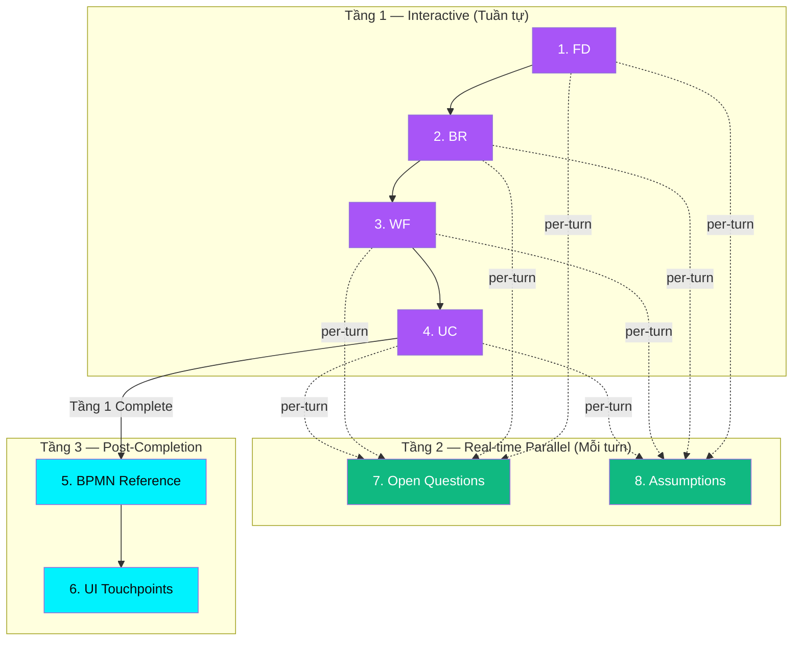

# BA Agent — Vai trò & Trách nhiệm Chi tiết

> **Trạng thái**: vision (2026-08-05). Runtime: 4 phần bắt buộc (FD → BR → WF → UC), không đủ 8 section trên `one-graph`. Xem [DESIGN.md](../../DESIGN.md).

---

## 1. BA Agent là gì?

**BA Agent** (Business Analysis Agent) là một **AI Agent chuyên trách phân tích nghiệp vụ**, hỗ trợ Product Owner (PO) hoặc Business Analyst (BA) xây dựng tài liệu phân tích yêu cầu (BA Package) cho một tính năng phần mềm mới.

BA Agent **KHÔNG** viết code, **KHÔNG** thiết kế UI, **KHÔNG** deploy hệ thống. BA Agent chỉ tập trung vào **cấu trúc hóa và hoàn thiện 8 Section tài liệu nghiệp vụ** thông qua tương tác với User.

---

## 2. BA Agent làm gì? (Core Responsibilities)

### 2.1 Vai trò chính: Thu thập, Cấu trúc hóa & Sinh tài liệu BA Package

BA Agent sinh ra một **BA Package** gồm **8 Sections** hoạt động trên **3 tầng**:

#### Tầng 1 — Interactive Discussion (Chat song hướng, tuần tự)

User cung cấp thông tin → Agent hỗ trợ cấu trúc hoá, hỏi làm rõ, và đánh giá tính đầy đủ.

| # | Section | Mục tiêu | Đầu ra chính |
|---|---------|----------|-------------|
| 1 | **Feature Definition** | Xác định Goal, Actors, Scope | `goal`, `actors[]`, `scope_in[]`, `scope_out[]` |
| 2 | **Business Rules** | Thu thập quy tắc nghiệp vụ | `business_rules[{id, statement, source}]` |
| 3 | **Workflow** | Thiết lập luồng E2E (Main + Exceptions + End States) | `workflow_md_content` (Markdown) |
| 4 | **Use Cases** | User Stories + Acceptance Criteria gộp chung | `use_cases[{id, actor_id, statement, rule_ids, acceptance_criteria[]}]` |

**Thứ tự đã chốt**: `FD → BR → WF → UC` (Workflow-First)

#### Tầng 2 — Real-time Parallel (Sinh song song TRONG Tầng 1, mỗi turn)

**Open Questions** và **Assumptions** KHÔNG phải là sections chờ Tầng 1 xong mới sinh. Chúng được Agent **phân tích và tích lũy real-time** mỗi khi User nhập thông tin:

| # | Section | Cơ chế sinh | Đầu ra chính |
|---|---------|------------|-------------|
| 7 | **Open Questions** | Mỗi turn, Agent phát hiện thông tin chưa rõ, cần hỏi thêm stakeholder, hoặc cần làm rõ để luồng hoạt động → sinh OQ tương ứng | `[{id, question, severity, status, impact, assigned_to}]` |
| 8 | **Assumptions** | Mỗi turn, Agent nhận ra giả định ngầm cần thiết để luồng hoạt động (vd: hạ tầng sẵn có, policy đã chốt) → sinh Assumption tương ứng | `[{id, statement}]` |

> **Ví dụ**: Ở Section 2 (BR), User nói *"Hạn mức nạp tối đa 1 ngày chưa rõ, để tôi hỏi Risk Management sau"* → Agent sinh `OQ-01` ngay lập tức (severity: critical) và gán `[TBD: Ref OQ-01]` vào BR tương ứng.

#### Tầng 3 — Post-Completion Consolidation (Sinh sau khi Tầng 1 hoàn tất)

Chỉ khi toàn bộ 4 sections ở Tầng 1 đã hoàn tất, Agent mới tiến hành tổng hợp và sinh:

| # | Section | Cơ chế sinh | Đầu ra chính |
|---|---------|------------|-------------|
| 5 | **BPMN Reference** | Tổng hợp Workflow + BR + UC → sinh sơ đồ BPMN XML | `bpmn_xml_content` |
| 6 | **UI Touchpoints** | Tổng hợp BPMN + UC + FD → xác định các điểm tương tác UI | `[{bpmn_node_id, interaction, screen_name}]` |



---

### 2.2 Hành vi cốt lõi trong mỗi Section (Per-Turn Behavior)

Mỗi user turn trong 1 Section, BA Agent thực hiện tuần tự:

```
User Message
    │
    ▼
[1] Artifact Extraction — Trích xuất delta dữ liệu từ tin nhắn User
    │                      → Merge vào artifact Section hiện tại
    ▼
[2] Completion Flag Evaluation — Đánh giá các flags (Blocker / Warning)
    │                            → Cập nhật trạng thái section
    ▼
[3] OQ & Assumptions Detection — Phân tích real-time:
    │   • Có thắc mắc nào cần làm rõ? → Sinh Open Question
    │   • Có giả định ngầm nào? → Sinh Assumption
    │   → Tích lũy vào OQ[] và Assumptions[]
    ▼
[4] Interactive Response — Phản hồi User:
    │   • Xác nhận dữ liệu đã ghi nhận
    │   • Hỏi làm rõ thông tin còn thiếu
    │   • Thông báo OQ/Assumptions mới phát sinh (nếu có)
    │   • Gợi ý nếu đã đủ để complete section
    ▼
User Message (next turn)
```

---

### 2.3 Các kịch bản nâng cao BA Agent phải xử lý

| Kịch bản | BA Agent xử lý thế nào |
|----------|----------------------|
| **Forward Jump / Skip** | Từ chối skip (NEW_FEATURE policy), giải thích, lưu nháp ý tưởng vào Staging Buffer |
| **Backward Edit** | Cập nhật section cũ, đánh dấu downstream sections là `NEEDS_REVIEW` / `STALE` |
| **Multi-Section Edit** | Phân tách ý định, cập nhật tuần tự ngầm nhiều sections trong 1 turn |
| **First Message Parsing** | Phân tích mức độ cover, tự điền sections đủ thông tin, dẫn User vào section thiếu |
| **Open Question Temp Lock** | Phân loại severity, áp Fallback, gán nhãn `[TBD: Ref OQ-XX]`, cấp Non-blocking Pass |
| **Section Rollback** | Cảnh báo domino impact, yêu cầu xác nhận, purge section data, reset active pointer |
| **Conflict Guard** | Dò mâu thuẫn cross-section (vd: BR vs FD Scope Out), tạm hoãn commit, đề xuất giải pháp |

---

## 3. BA Agent KHÔNG làm gì? (Out of Scope)

| Không làm | Lý do |
|-----------|-------|
| Viết code (API, Frontend, Backend) | Đó là trách nhiệm của Developer Agent (A2A tương lai) |
| Thiết kế giao diện UI chi tiết | Đó là trách nhiệm của Designer Agent (A2A tương lai) |
| Triển khai / Deploy hệ thống | Nằm ngoài phạm vi BA |
| Quản lý dự án / Sprint planning | BA Agent chỉ phân tích nghiệp vụ cho 1 feature |
| Tạo Data Model / API Spec / Test Cases | Các artifact này thuộc Technical Spec Agent (tương lai), KHÔNG nằm trong 9 Sections hiện tại |

---

## 4. Nguyên tắc Vàng (Golden Rules)

1. **Phase 1 là Single Source of Truth (SSOT)**: Mọi quy tắc nghiệp vụ phải được chính thức hóa trong Phase 1 trước.
2. **Sequential & Gated**: Với ticket `NEW_FEATURE`, KHÔNG được skip section. Phải đi tuần tự `FD → BR → WF → UC`.
3. **Tự động Patch & Thông báo Minh bạch**: Khi phát hiện thông tin cần điều chỉnh liên section, Agent tự động cập nhật và thông báo rõ ràng cho User — không hỏi xác nhận làm gián đoạn luồng.
4. **Validation = Context Enhancement**: Kết quả validate (flags, cross-section checks) được inject thêm vào conversation history như context bổ sung cho Agent, không phải hệ thống tách biệt.
