# BA Agent — Kiến trúc Hệ thống Thống nhất (Unified Graph Agent)

> **Trạng thái**: vision (2026-08-05). Runtime map: [DESIGN.md](../../DESIGN.md). Validate **không** phải HTTP A2A trên `one-graph`.
> **Quyết định kiến trúc**: ADK Workflow (State Graph) — Unified cho cả Phase 1 & Phase 2

---

## 1. Tầm nhìn Kiến trúc: Unified System — Không tách Stage

### Quyết định đã chốt

> **KHÔNG** chia thành Stage 1, Stage 2 riêng biệt.  
> → Xây **MỘT hệ thống thống nhất** bao gồm tất cả 8 Sections trong 1 ADK Workflow Graph.

### Lý do

- Hệ thống BA Agent là **1 luồng liên tục**: User thảo luận → Agent trích xuất → Flags đánh giá → Chuyển section → Auto-gen Phase 2 → User review → Backward edit → Cập nhật liên tục.
- Tách Stage thành hệ thống riêng sẽ tạo ra friction và complexity không cần thiết.

### 2 Tầng Validation

BA Agent có **2 tầng validation** rõ ràng:

| Tầng | Ai làm | Khi nào | Mục đích |
|------|--------|---------|----------|
| **Internal Checks** | BA Agent (nội bộ) | Mỗi user turn | Completion Flags, OQ/ASM Detection, Cross-section Conflict Guard |
| **External Validation** | Validate Agent (A2A) | User bấm nút Validate | Validate toàn bộ BA Package, cross-feature checks, business logic rules |

- **Internal Checks** = logic nội bộ của BA Agent, chỉ kiểm tra **trong 1 feature**.
- **External Validation** = A2A với Validate Agent riêng, có thể kiểm tra **giữa các features** và các quy tắc phức tạp hơn.

---

## 2. Kiến trúc: ADK Workflow Graph

### Mô hình đã chọn: **Option C — State Graph Workflow** (Google ADK)

```mermaid
flowchart TD
    START([START: User Turn]) --> ROUTER

    subgraph TIER1["Tầng 1 — Interactive Discussion (Tuần tự)"]
        ROUTER["🔀 Router Node<br/>(FunctionNode)<br/>Phân tích intent + route"]

        subgraph FD_SUB["Section 1: Feature Definition"]
            FD_EXT["📥 FD Extractor<br/>(LlmAgent)<br/>output_schema: FD Model"]
            FD_DISC["💬 FD Discussion<br/>(LlmAgent)<br/>Hỏi làm rõ, xác nhận"]
            FD_EXT --> FD_DISC
        end

        subgraph BR_SUB["Section 2: Business Rules"]
            BR_EXT["📥 BR Extractor<br/>(LlmAgent)<br/>output_schema: BR Model"]
            BR_DISC["💬 BR Discussion<br/>(LlmAgent)<br/>Hỏi làm rõ, xác nhận"]
            BR_EXT --> BR_DISC
        end

        subgraph WF_SUB["Section 3: Workflow"]
            WF_EXT["📥 WF Extractor<br/>(LlmAgent)<br/>output_schema: WF Model"]
            WF_DISC["💬 WF Discussion<br/>(LlmAgent)<br/>Hỏi làm rõ, xác nhận"]
            WF_EXT --> WF_DISC
        end

        subgraph UC_SUB["Section 4: Use Cases"]
            UC_EXT["📥 UC Extractor<br/>(LlmAgent)<br/>output_schema: UC Model"]
            UC_DISC["💬 UC Discussion<br/>(LlmAgent)<br/>Hỏi làm rõ, xác nhận"]
            UC_EXT --> UC_DISC
        end

        ROUTER -->|"route=fd"| FD_EXT
        ROUTER -->|"route=br"| BR_EXT
        ROUTER -->|"route=wf"| WF_EXT
        ROUTER -->|"route=uc"| UC_EXT
    end

    subgraph TIER2["Tầng 2 — Real-time Parallel (Mỗi turn)"]
        FLAGS["🏁 Completion Flags<br/>(FunctionNode)<br/>Đánh giá Blocker/Warning"]
        OQ_DET["❓ OQ Detection<br/>(LlmAgent)<br/>Phát hiện câu hỏi mở"]
        ASM_DET["💡 ASM Detection<br/>(LlmAgent)<br/>Phát hiện giả định ngầm"]
    end

    subgraph UTILITY["Shared Utility Nodes"]
        CONFLICT["⚠️ Cross-Section<br/>Conflict Guard<br/>(FunctionNode)"]
        ROLLBACK["🔄 Rollback Guard<br/>(FunctionNode)<br/>Reset + Domino"]
        MULTI["📤 Multi-Section<br/>Distributor<br/>(FunctionNode)"]
    end

    subgraph TIER3["Tầng 3 — Post-Completion (Sau Tầng 1)"]
        BPMN_GEN["📊 BPMN Generator<br/>(LlmAgent)<br/>Sinh BPMN XML"]
        UI_GEN["🖥️ UI Touchpoints<br/>(LlmAgent)<br/>Xác định screens"]
    end

    subgraph A2A_LAYER["A2A — External Validation"]
        VALIDATE["✅ Validate Proxy<br/>(FunctionNode, NO LLM)<br/>Gọi A2A → Validate Agent"]
    end

    %% Section self-loops (continue thảo luận)
    FD_DISC -->|"continue"| ROUTER
    BR_DISC -->|"continue"| ROUTER
    WF_DISC -->|"continue"| ROUTER
    UC_DISC -->|"continue"| ROUTER

    %% Per-turn: sau mỗi section extraction → flags + OQ/ASM
    FD_EXT -.->|"per-turn"| FLAGS
    BR_EXT -.->|"per-turn"| FLAGS
    WF_EXT -.->|"per-turn"| FLAGS
    UC_EXT -.->|"per-turn"| FLAGS

    FLAGS -.-> OQ_DET
    FLAGS -.-> ASM_DET

    OQ_DET -.->|"inject history"| ROUTER
    ASM_DET -.->|"inject history"| ROUTER

    %% Utility routes
    ROUTER -->|"route=rollback"| ROLLBACK
    ROUTER -->|"route=multi_edit"| MULTI
    ROLLBACK --> ROUTER
    MULTI --> ROUTER

    %% Cross-section guard (per-turn)
    FLAGS -.-> CONFLICT
    CONFLICT -.->|"inject warning"| ROUTER

    %% Post-completion
    UC_DISC -->|"Tầng 1 Complete"| BPMN_GEN
    BPMN_GEN --> UI_GEN
    UI_GEN --> END_NODE

    %% Validate (A2A)
    ROUTER -->|"route=validate"| VALIDATE
    VALIDATE --> END_NODE

    END_NODE([END: Response to User])

    %% Styling
    style TIER1 fill:#f3e8ff,stroke:#A855F7,stroke-width:2px
    style TIER2 fill:#d1fae5,stroke:#10B981,stroke-width:2px
    style TIER3 fill:#cffafe,stroke:#06B6D4,stroke-width:2px
    style A2A_LAYER fill:#fef3c7,stroke:#F59E0B,stroke-width:2px
    style UTILITY fill:#fee2e2,stroke:#EF4444,stroke-width:2px

    style ROUTER fill:#7C3AED,color:#fff
    style FLAGS fill:#059669,color:#fff
    style OQ_DET fill:#10B981,color:#fff
    style ASM_DET fill:#10B981,color:#fff
    style CONFLICT fill:#DC2626,color:#fff
    style ROLLBACK fill:#DC2626,color:#fff
    style MULTI fill:#DC2626,color:#fff
    style VALIDATE fill:#D97706,color:#fff
    style BPMN_GEN fill:#0891B2,color:#fff
    style UI_GEN fill:#0891B2,color:#fff
```



**Chú thích đường nét**:
- **Nét liền (→)**: Edge chính trong Graph — luồng thực thi tuần tự
- **Nét đứt (-.->)**: Per-turn side-effects — chạy song song, inject vào state/history

**Session State (`ctx.state`)** — SSOT cho toàn bộ:
- `artifacts{}` — data 8 sections
- `sections_status{}` — trạng thái mỗi section
- `flags{}` — completion flags
- `open_questions[]` — OQ tích lũy
- `assumptions[]` — ASM tích lũy
- `feature_status` — DRAFT / IN_PROGRESS / PENDING_VALIDATION / ...
- `validation_result` — kết quả validate A2A gần nhất

### Tại sao không dùng Option A (Hierarchical Router) hay Option B (Single Master)?

| Option | Lý do bỏ |
|--------|---------|
| **A — Hierarchical Router + Section Pipelines** | Phức tạp hóa, khó kiểm soát backward edit giữa nhiều pipeline |
| **B — Single Master Agent + Tools** | Prompt quá dài, LLM dễ đi lệch khi quản lý 9 sections cùng lúc |
| **C — State Graph Workflow** ✅ | Kiểm soát luồng chặt chẽ bằng edges & routes, không lo LLM đi chệch |

---

## 3. Các Thành phần Chính trong Graph

### 3.1 Router Node (FunctionNode)
- **Vai trò**: Phân tích ý định User mỗi turn, xác định target section và intent type.
- **Input**: User message + `ctx.state` (active_section, sections_status, artifacts).
- **Output**: `Event(route="fd" | "br" | "wf" | "uc" | "bpmn" | "ui_tp" | "multi_edit" | "rollback" | "validate")`.

### 3.2 Section Nodes (LlmAgent hoặc SequentialAgent)
- **Mỗi section**: 1 Node (hoặc sub-graph nội bộ gồm Extractor + Discussion).
- **Extractor**: LlmAgent với `output_schema=SectionDataModel` — trích xuất delta data.
- **Discussion**: LlmAgent phản hồi User — hướng dẫn, hỏi làm rõ.
- **Self-Loop**: Mỗi Section Node lặp lại (route `"continue"`) cho đến khi User complete.

### 3.3 Shared Utility Nodes (FunctionNode)
- **Cross-Section Conflict Guard**: Dò mâu thuẫn giữa sections trong cùng 1 feature.
- **Rollback Guard**: Xử lý reset section + domino invalidation.
- **Multi-Section Distributor**: Phân tách 1 câu ảnh hưởng nhiều sections.

### 3.4 Validate Proxy Node (FunctionNode, KHÔNG dùng LLM)
- **Vai trò**: Đầu mối gọi A2A Validate Agent khi User bấm nút Validate.
- **Input**: Toàn bộ artifacts, flags, ticket_type, sections_status, OQ[], ASM[] từ `ctx.state`.
- **Output**: Pass-through response từ Validate Agent (không qua LLM của BA Agent).
- **Chi tiết**: Xem [02b-IO-validate-ba-agent.md](02b-IO-validate-ba-agent.md).

---

## 4. 2 Tầng Validation

### 4.1 Internal Checks (BA Agent nội bộ — mỗi turn)

BA Agent có logic kiểm tra riêng chạy **mỗi user turn**, chỉ kiểm tra **trong phạm vi 1 feature**:

```
Mỗi User Turn:
    1. Extractor trích xuất data → merge vào artifact
    2. Completion Flags Evaluation — đánh giá tính đầy đủ mỗi section
    3. OQ & Assumptions Detection — phân tích real-time
    4. Cross-section Conflict Guard — dò mâu thuẫn giữa sections
    5. Kết quả được INJECT VÀO conversation history
       → Discussion Agent đọc context → phản hồi thông minh
```

| Loại check | Ví dụ | Scope |
|-----------|-------|-------|
| Completion Flags | FD-F1: Goal defined? | Trong 1 section |
| Cross-section Conflict | BR mâu thuẫn FD Scope Out | Giữa các sections **trong cùng 1 feature** |
| OQ Detection | User nói "chưa rõ" → sinh OQ | Trong 1 feature |
| ASM Detection | Giả định ngầm về infra | Trong 1 feature |

> **Giới hạn**: Internal Checks chỉ kiểm tra **nội bộ 1 feature**. Không thể kiểm tra giữa feature này với feature cũ khác, hoặc các quy tắc business phức tạp ngoài phạm vi BA Package hiện tại.

### 4.2 External Validation (A2A Validate Agent — khi User bấm nút)

Khi User bấm nút **Validate**, BA Agent gọi Validate Agent qua **A2A protocol**:

```
User bấm [Validate]
    │
    ▼
Router Node → route = "validate"
    │
    ▼
Validate Proxy Node (FunctionNode, KHÔNG dùng LLM)
    │
    ├── Gửi full payload qua A2A → Validate Agent
    │       • artifacts, flags, ticket_type, sections_status
    │       • open_questions[], assumptions[]
    │
    ├── Nhận response từ Validate Agent:
    │       • "passed" / "failed" / "no_change"
    │       • validation_report (chi tiết lỗi, gợi ý sửa)
    │
    ├── Cập nhật ctx.state["feature_status"]
    │
    └── Return validation_report làm output của Node
        → Đây chính là message trả về User (pass-through, KHÔNG qua LLM)
        → Tự động nằm trong conversation history
        → Turn sau BA Agent tự thấy (không cần inject riêng)
```

| Khác biệt | Internal Checks | External Validation (A2A) |
|-----------|----------------|---------------------------|
| **Ai làm** | BA Agent (nội bộ) | Validate Agent (remote) |
| **Khi nào** | Mỗi user turn | User bấm nút Validate |
| **Scope** | Trong 1 feature | Cross-feature, business rules phức tạp |
| **Dùng LLM?** | Có (flags, OQ, conflict guard) | Không (BA Agent chỉ proxy) |
| **Kết quả** | Inject vào history làm context | Cập nhật `ctx.state["feature_status"]` + return output làm message |

> **Chi tiết luồng Validation A2A, I/O Contract**: Xem [02b-IO-validate-ba-agent.md](02b-IO-validate-ba-agent.md).  
> **Feature Status Lifecycle, Required Matrix**: Xem [02a-feature-status.md](02a-feature-status.md).

---

## 5. 3 Tầng hoạt động: Cùng 1 Graph, Cùng 1 State

### Quyết định đã chốt

Tất cả 8 sections nằm trong cùng 1 ADK Workflow Graph, hoạt động trên **3 tầng**:

| Tầng | Sections | Cơ chế | Thời điểm |
|------|----------|--------|----------|
| **Tầng 1 — Interactive** | FD, BR, WF, UC | User chat ↔ Agent tuần tự | Từ đầu đến hoàn tất 4 sections |
| **Tầng 2 — Real-time Parallel** | OQ, Assumptions | Agent tự sinh per-turn song song Tầng 1 | Mỗi turn, tích lũy dần |
| **Tầng 3 — Post-Completion** | BPMN, UI Touchpoints | Agent tổng hợp → User review | Sau khi Tầng 1 hoàn tất |

### Lý do

- OQ & Assumptions sinh **song song** trong quá trình Discussion → User thấy được gaps/assumptions sớm.
- BPMN & UI Touchpoints cần **toàn bộ data Tầng 1** → chỉ sinh khi 4 sections đã complete.
- State (artifacts, flags, OQ[], ASM[]) là 1 nguồn duy nhất — không cần sync giữa nhiều hệ thống.

### Tác động 2 chiều đã chốt

| Hướng | Ví dụ | Hành vi |
|-------|-------|---------|
| **Tầng 1 → Tầng 3** | Sửa BR-02 ở Phase 1 | Đánh dấu BPMN, UI Touchpoints là `STALE`, tự động re-gen & thông báo |
| **Tầng 3 → Tầng 1** | Review BPMN phát hiện thiếu exception flow | Agent đề xuất bổ sung vào Workflow, thông báo User |
| **Tầng 2 liên tục** | Mỗi turn đều có thể sinh thêm OQ/ASM | Tích lũy, thông báo minh bạch |

**Cơ chế phản hồi User**: Tự động Patch & Thông báo Minh bạch — không hỏi xác nhận (trừ khi Rollback/Purge).
