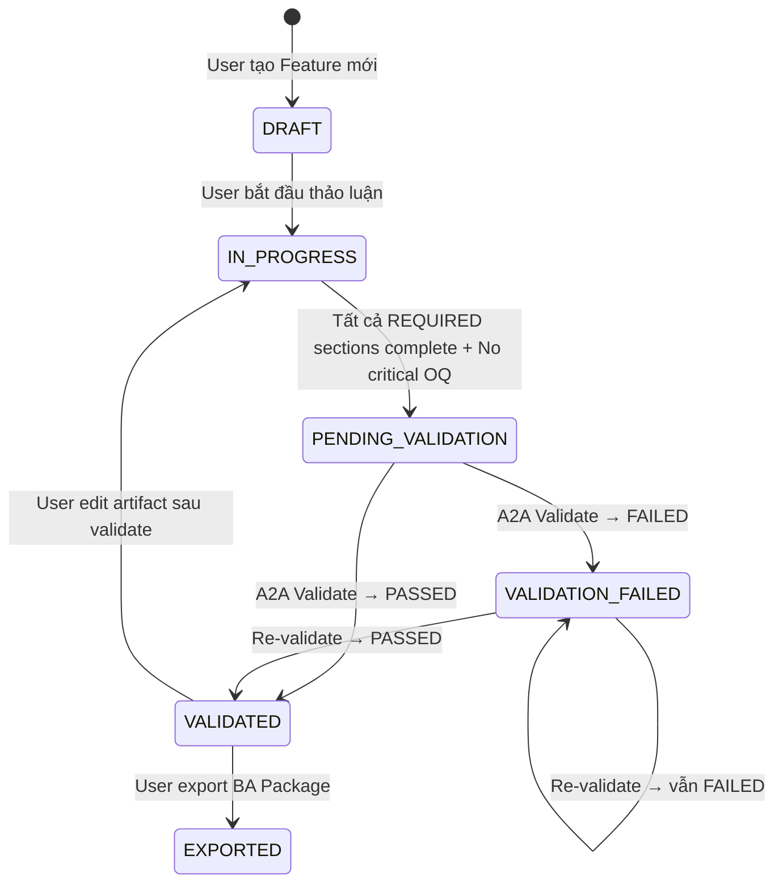

# BA Agent — Feature Status Lifecycle

> **Trạng thái**: mostly aligned with runtime. Confirmed 2026-08-05; see also [DESIGN.md](../../DESIGN.md).

---

## 1. Feature Status Lifecycle — 6 Trạng thái



### Bảng Status

| Status | Mô tả | Nút Validate | Nút Export | BA Agent |
|--------|-------|:------------:|:----------:|----------|
| `DRAFT` | Feature vừa tạo, chưa thảo luận | ❌ Disabled | ❌ Disabled | Chờ user gửi message đầu tiên |
| `IN_PROGRESS` | Đang thảo luận với BA Agent | ❌ Disabled | ❌ Disabled | Chat active, extraction + flags |
| `PENDING_VALIDATION` | Đủ điều kiện validate | ✅ **Enabled** | ❌ Disabled | Thông báo "Sẵn sàng validate" |
| `VALIDATED` | A2A Validate trả PASSED | ✅ Enabled (re-validate) | ✅ **Enabled** | Badge ✅, sẵn sàng export |
| `VALIDATION_FAILED` | A2A Validate trả FAILED | ✅ **Enabled** (re-validate) | ❌ Disabled | Hiện report lỗi, hỗ trợ fix |
| `EXPORTED` | Đã xuất BA Package | ✅ Enabled (refresh vs wiki) | ✅ Enabled if last VA passed | Chat frozen; Validate/Export still refresh |

---

## 2. Transition Rules

| From | To | Trigger | Condition |
|------|----|---------|-----------|
| `DRAFT` | `IN_PROGRESS` | User gửi message đầu tiên | — |
| `IN_PROGRESS` | `PENDING_VALIDATION` | **Tự động** | Tất cả REQUIRED sections (theo ticket_type) complete + no critical OQ open |
| `PENDING_VALIDATION` | `VALIDATED` | User bấm Validate | A2A Validate Agent trả `passed` |
| `PENDING_VALIDATION` | `VALIDATION_FAILED` | User bấm Validate | A2A Validate Agent trả `failed` / `error` |
| `VALIDATION_FAILED` | `VALIDATED` | User bấm Re-validate | A2A trả `passed` sau khi fix |
| `VALIDATION_FAILED` | `VALIDATION_FAILED` | User bấm Re-validate | A2A vẫn trả `failed` (chưa fix đủ) |
| `VALIDATED` | `IN_PROGRESS` | User edit bất kỳ artifact nào | Artifact thay đổi → cần re-validate |
| `VALIDATED` | `EXPORTED` | User bấm Export | — |

### Quy tắc đặc biệt

- **VALIDATION_FAILED + User edit**: Status **KHÔNG đổi**. Giữ `VALIDATION_FAILED` cho đến khi User bấm Validate lại và A2A trả kết quả mới.
- **VALIDATED + User edit**: Chuyển về `IN_PROGRESS` vì artifact đã thay đổi so với lần validate trước.
- **Change Detection**: Trách nhiệm của **Validate Agent**, KHÔNG phải BA Agent. BA Agent luôn gửi full artifacts, Validate Agent tự so sánh với snapshot trước.

---

## 3. Điều kiện Enable nút Validate (UI Logic)

```python
def can_show_validate_button(feature_status: str) -> bool:
    """Nút Validate hiển thị (enabled) khi nào."""
    return feature_status in [
        "PENDING_VALIDATION",   # Lần đầu validate
        "VALIDATED",            # Re-validate (optional)
        "VALIDATION_FAILED",    # Re-validate (sau khi fix)
    ]
```

Điều kiện chuyển từ `IN_PROGRESS` → `PENDING_VALIDATION` (tự động):

```python
def check_auto_transition_to_pending(
    ticket_type: str,
    sections_status: dict,
    open_questions: list,
) -> bool:
    """Tự động chuyển sang PENDING_VALIDATION khi đủ điều kiện."""
    required_sections = TICKET_REQUIRED_MATRIX[ticket_type]
    
    # Tất cả REQUIRED sections phải complete
    for section_id in required_sections:
        if sections_status.get(section_id, {}).get("status") != "completed":
            return False
    
    # Không có OQ critical nào open
    critical_oqs = [
        oq for oq in open_questions
        if oq["severity"] == "critical" and oq["status"] == "open"
    ]
    return len(critical_oqs) == 0
```

---

## 4. Ticket Type Required Matrix

| Section | NEW_FEATURE | FEATURE_ENHANCEMENT | BUG_FIX_LOG | PROCESS_OPTIMIZATION |
|---------|:-----------:|:-------------------:|:-----------:|:--------------------:|
| FD | 🔴 REQUIRED | 🟡 Optional | ⚪ DISABLED | 🟡 Optional |
| BR | 🔴 REQUIRED | 🔴 REQUIRED | 🔴 REQUIRED | 🟡 Optional |
| WF | 🔴 REQUIRED | 🔴 REQUIRED | 🟡 Optional | 🔴 REQUIRED |
| UC | 🔴 REQUIRED | 🔴 REQUIRED | ⚪ DISABLED | 🟡 Optional |
| BPMN | 🟡 Optional | 🟡 Optional | ⚪ DISABLED | 🔴 REQUIRED |
| UI TP | 🟡 Optional | 🟡 Optional | ⚪ DISABLED | 🟡 Optional |
| OQ | 🟡 Conditional | 🟡 Conditional | 🟡 Conditional | 🟡 Conditional |
| ASM | 🟡 Optional | 🟡 Optional | ⚪ DISABLED | 🔴 REQUIRED |

> **Xem thêm**: Luồng Validation A2A, I/O Contract → [02b-IO-validate-ba-agent.md](02b-IO-validate-ba-agent.md)
