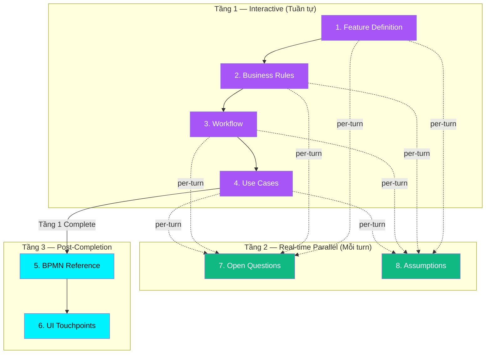

# BA Agent — Input & Output Artifacts Chi tiết (8 Sections)

> **Trạng thái**: vision (2026-08-05). Runtime chỉ khóa 4 phần Tier-1. Xem [README.md](README.md).

---

## Tổng quan

Mỗi Section có:
- **Input**: Dữ liệu đầu vào (từ User hoặc từ sections trước).
- **Output (Artifact)**: Dữ liệu có cấu trúc mà Agent trích xuất/sinh ra.
- **Completion Flags & Priority ($P_1 \dots P_n$)**: Thứ tự ưu tiên cho từng flag. Đảm bảo hệ thống luôn xác định được thông tin quan trọng nhất đang thiếu.
- **Natural Language Communication Protocol**: Mọi trao đổi với User đều dùng ngôn ngữ tự nhiên nghiệp vụ, tuyệt đối KHÔNG đề cập mã kỹ thuật (như `FD-F1`, `BR-F2`...) trong câu trả lời.

---

## Tầng 1 — Interactive Discussion (Tuần tự)

---

### Section 1: Feature Definition

**Input từ User**: Mô tả tự do về feature muốn phân tích.

**Output Artifact**:
```json
{
  "goal": "string — WHY feature này cần tồn tại (business value)",
  "actors": ["string — Actor: mô tả vai trò"],
  "scope_in": ["string — capability thuộc phạm vi"],
  "scope_out": ["string — capability KHÔNG thuộc phạm vi"]
}
```

**Completion Flags & Priority**:

| Priority | Flag ID | Name | Điều kiện PASS | Severity | Check | Lý do & Hướng dẫn Gợi ý cho User |
|:---:|---------|------|---------------|----------|-------|----------------------------------|
| 🥇 **P1** | `FD-F1` | Goal defined | `goal` ≠ empty AND chứa business value | 🔴 Blocker | 🧠 Code + Semantic | Không có goal → tính năng vô định. **Gợi ý**: Đề xuất 2-3 mục tiêu kinh doanh đo lường được. |
| 🥈 **P2** | `FD-F2` | Actors listed | `actors[]` ≥ 2 (1 primary + 1 system/external) | 🔴 Blocker | ⚙️ Code | Đếm `len(actors)`. **Gợi ý**: Đề xuất các vai trò/hệ thống tham gia phổ biến. |
| 🥉 **P3** | `FD-F3` | Scope In defined | `scope_in[]` ≥ 1 item | 🔴 Blocker | ⚙️ Code | Đếm `len(scope_in)`. **Gợi ý**: Đề xuất 2-3 tính năng cốt lõi thuộc phạm vi. |
| **P4** | `FD-F5` | No scope conflict | Không mâu thuẫn giữa `scope_in` và `scope_out` | 🔴 Blocker | 🧠 Semantic | LLM so sánh ngữ nghĩa 2 danh sách. Chỉ ra vị trí mâu thuẫn để User làm rõ. |
| **P5** | `FD-F4` | Scope Out defined | `scope_out[]` ≥ 1 item | 🟡 Warning | ⚙️ Code | Tránh scope creep (không chặn luồng). |

**Dependencies**: Không có (Section đầu tiên).

---

### Section 2: Business Rules

**Input**: Feature Definition (`goal`, `actors`, `scope_in`, `scope_out`).

**Output Artifact**:
```json
[
  {
    "id": "BR-01",
    "statement": "string — quy tắc cụ thể, đo lường được (trigger condition + expected outcome)",
    "source": "Policy | System | Security | PO | Legal"
  }
]
```

**Completion Flags**:

| Flag ID | Name | Điều kiện PASS | Severity | Check | Lý do |
|---------|------|---------------|----------|-------|-------|
| `BR-F1` | Min rules count | `business_rules[]` ≥ 2 | 🔴 Blocker | ⚙️ Code | Đếm `len(business_rules)`. Feature cần tối thiểu 2 BR |
| `BR-F2` | All have source | Mỗi BR có `source` ≠ empty | 🟡 Warning | ⚙️ Code | Check `source ≠ null/empty` mỗi item. Giúp truy vết nhưng không chặn luồng |
| `BR-F3` | Statements measurable | Mỗi `statement` có trigger + outcome | 🟡 Warning | 🧠 Semantic | LLM phân tích câu có chứa điều kiện + kết quả không. Cải thiện dần được |
| `BR-F4` | No contradiction | Không có 2 BRs mâu thuẫn nhau | 🔴 Blocker | 🧠 Semantic | LLM so sánh từng cặp BR để phát hiện mâu thuẫn ngữ nghĩa. 2 BR mâu thuẫn → lỗi logic |
| `BR-F5` | True business rules | Không lẫn technical constraints / assumptions | 🟡 Warning | 🧠 Semantic | LLM phân loại câu là business rule hay technical. Lẫn vào gây nhầm nhưng không chặn luồng |

**Dependencies**: ← `feature_definition` (actors, scope).

---

### Section 3: Workflow

**Input**: Feature Definition (`actors`, `scope`) + Business Rules (`business_rules[]`).

**Output Artifact**:
```json
{
  "artifact_id": "WF-{MODULE}-001",
  "version": "1.0.0",
  "workflow_md_path": "path/to/workflow.md",
  "workflow_md_content": "# Workflow Markdown\n## Main Flow\n| Step | Actor | Action | BR Ref |\n## Exception Flows\n## End States\n## Sequence Diagram (mermaid)"
}
```

**Workflow MD Structure**:
1. **Main Flow**: Bảng `Step | Actor | Action | BR Ref`
2. **Exception Flows**: `E-01`, `E-02`, ... mô tả cụ thể
3. **End States**: Danh sách trạng thái kết thúc
4. **Sequence Diagram**: Mermaid `sequenceDiagram`

**Completion Flags**:

| Flag ID | Name | Điều kiện PASS | Severity | Check | Lý do |
|---------|------|---------------|----------|-------|-------|
| `WF-F1` | Main flow defined | ≥ 3 bước (trigger → process → end) | 🔴 Blocker | 🧠 Semantic | LLM đếm số bước trong MD. Thiếu thì không thể sinh BPMN |
| `WF-F2` | End-to-end coverage | Luồng từ trigger → End State rõ ràng | 🔴 Blocker | 🧠 Semantic | LLM đánh giá luồng có liên tục từ đầu đến cuối không |
| `WF-F3` | Exception flows exist | ≥ 1 exception flow | 🟡 Warning | 🧠 Semantic | LLM kiểm tra có section Exception Flows trong MD không |
| `WF-F4` | Actor consistency | Actors khớp `feature_definition.actors[]` | 🔴 Blocker | 🧠 Semantic | LLM trích xuất actors từ MD rồi so với FD.actors[] |
| `WF-F5` | BR references | Các bước tham chiếu BR-XX | 🟡 Warning | 🧠 Semantic | LLM kiểm tra bảng Main Flow có cột BR Ref không |
| `WF-F6` | End states defined | Có danh sách End States | 🟡 Warning | 🧠 Semantic | LLM kiểm tra có section End States trong MD không |

**Dependencies**: ← `feature_definition` + `business_rules`.

---

### Section 4: Use Cases (gộp User Stories + Acceptance Criteria)

**Input**: Feature Definition (`actors[]`) + Business Rules (`business_rules[]`) + Workflow (`main_flow`, `exception_flows`).

**Output Artifact**:
```json
[
  {
    "id": "US-01",
    "actor_id": "ACT-CUSTOMER",
    "statement": "Là khách hàng, tôi muốn [goal] để [value].",
    "rule_ids": ["BR-01", "BR-02"],
    "bpmn_node_ids": [],
    "acceptance_criteria": [
      {
        "id": "AC-01",
        "given": "string — precondition / initial state",
        "when": "string — single trigger action",
        "then": "string — observable, testable result"
      }
    ]
  }
]
```

> **Note**: `bpmn_node_ids` sẽ được back-fill sau khi BPMN Reference (Section 5) approved.

**Completion Flags**:

| Flag ID | Name | Điều kiện PASS | Severity | Check | Lý do |
|---------|------|---------------|----------|-------|-------|
| `UC-F1` | Min use cases count | `use_cases[]` ≥ 1 | 🔴 Blocker | ⚙️ Code | Đếm `len(use_cases)`. Không có UC → BPMN và UI TP không thể sinh |
| `UC-F2` | Statement format | Mỗi `statement` chứa pattern "muốn ... để ..." | 🔴 Blocker | 🧠 Code + Semantic | Regex bắt pattern cơ bản + LLM xác nhận có đủ actor/goal/value. Dev/QA không hiểu nếu thiếu |
| `UC-F3` | Actor validity | `actor_id` tồn tại trong `FD.actors[]` | 🔴 Blocker | ⚙️ Code | Lookup `actor_id in FD.actors`. Actor không có → UC orphan |
| `UC-F4` | Rule linkage | `rule_ids[]` ≥ 1 và ID tồn tại trong BR | 🟡 Warning | ⚙️ Code | Check `len(rule_ids) ≥ 1` + lookup ID. User có thể chưa map hết BR |
| `UC-F5` | No duplicate | Không có 2 UC trùng scope | 🔴 Blocker | 🧠 Semantic | LLM so sánh ngữ nghĩa các UC. Trùng scope gây nhầm lẫn cho Dev |
| `UC-F6` | Actor coverage | Tất cả actors chính có ≥ 1 UC | 🟡 Warning | ⚙️ Code | Check mỗi actor_id có ≥ 1 UC. Một số actors phụ chưa cần UC ngay |
| `UC-F7` | AC exists | Mỗi UC có ≥ 1 AC | 🔴 Blocker | ⚙️ Code | Đếm `len(acceptance_criteria)` mỗi UC. Không AC → QA không biết test gì |
| `UC-F8` | Happy path AC | Mỗi UC có ≥ 1 AC cho happy path | 🔴 Blocker | 🧠 Semantic | LLM phân tích AC nào là happy path. Thiếu → không có tiêu chí nghiệm thu luồng chính |

**Dependencies**: ← `feature_definition` + `business_rules` + `workflow`.

---

## Tầng 2 — Real-time Parallel (Sinh song song mỗi turn trong Tầng 1)

> OQ và Assumptions **KHÔNG** chờ Phase 1 xong mới sinh. Chúng được Agent phân tích và tích lũy **mỗi user turn** trong suốt quá trình Discussion ở Tầng 1.

---

### Section 7: Open Questions (Real-time per-turn)

**Cơ chế**: Mỗi turn ở bất kỳ Section nào (FD, BR, WF, UC), Agent phát hiện thông tin chưa rõ, cần hỏi thêm stakeholder, hoặc cần làm rõ → sinh OQ tương ứng ngay lập tức.

**Output Artifact** (tích lũy dần):
```json
[
  {
    "id": "OQ-001",
    "question": "string — câu hỏi kết thúc bằng ?",
    "severity": "critical | warning | info",
    "status": "open | resolved",
    "impact": "string — ảnh hưởng đến luồng/component nào",
    "answer": "string | null",
    "assigned_to": "string — PO / Tech Lead / BA / Designer",
    "source_section": "string — section nào phát sinh (vd: business_rules)",
    "source_turn": "int — turn # khi phát sinh"
  }
]
```

**Trigger Rules** (per-turn):
- BR thiếu edge case → `warning`
- Workflow nhánh exception chưa có policy → `critical`
- Actor action chưa rõ → `critical`
- Scope ↔ BR alignment gap → `warning`
- User nói "chưa rõ", "để hỏi lại" → `critical` + gán `[TBD: Ref OQ-XX]`

**Ví dụ**: Ở Section 2 (BR), User nói *"Hạn mức nạp tối đa 1 ngày chưa rõ, để tôi hỏi Risk Management sau"* → Agent sinh `OQ-01` ngay (severity: `critical`, source_section: `business_rules`).

---

### Section 8: Assumptions (Real-time per-turn)

**Cơ chế**: Mỗi turn, Agent nhận ra giả định ngầm cần thiết để luồng hoạt động → sinh Assumption tương ứng.

**Output Artifact** (tích lũy dần):
```json
[
  {
    "id": "ASM-01",
    "statement": "string — giả định cụ thể, có thể verify/invalidate",
    "source_section": "string — section nào phát sinh",
    "source_turn": "int — turn # khi phát sinh"
  }
]
```

**Trigger Rules** (per-turn):
- FD scope giả định infra → "Hệ thống đã có API gateway sẵn"
- BR giả định external system → "Ngân hàng đã cấu hình callback"
- Workflow giả định system state → "DB isolation = SERIALIZABLE"
- User nói "giả sử", "mặc định là" → tạo ASM tương ứng

---

## Tầng 3 — Post-Completion Consolidation (Sinh sau khi Tầng 1 hoàn tất)

> Chỉ khi toàn bộ 4 sections ở Tầng 1 đã hoàn tất, Agent mới tiến hành tổng hợp và sinh BPMN + UI Touchpoints.

---

### Section 5: BPMN Reference

**Input (Tổng hợp sources)**: Feature Definition + Business Rules + Use Cases + Workflow.

**Output Artifact**:
```json
{
  "artifact_id": "BPMN-{MODULE}-001",
  "version": "1.0.0",
  "bpmn_xml_path": "path/to/feature.bpmn",
  "bpmn_xml_content": "<bpmn:definitions ...>...</bpmn:definitions>"
}
```

**Generation Rules**:
- Mỗi bước Main Flow → 1 `<bpmn:task>`
- Mỗi Actor → 1 `<bpmn:lane>`
- Mỗi Exception Flow → `<bpmn:exclusiveGateway>` + error path
- Mỗi End State → 1 `<bpmn:endEvent>`

**Post-Approval Trigger**: Back-fill `bpmn_node_ids` vào Use Cases (Section 4).

**Dependencies**: ← Tầng 1 hoàn tất (tất cả 4 sections).

---

### Section 6: UI Touchpoints (Hybrid: AI-Suggest → User-Refine)

**Input (Tổng hợp sources)**: BPMN Reference + Use Cases + Feature Definition + Business Rules.

**Output Artifact**:
```json
[
  {
    "bpmn_node_id": "Task_XXX",
    "interaction": "form | display | notification | confirmation",
    "screen_name": "string — mô tả cụ thể màn hình"
  }
]
```

**Generation Rules**:
- `bpmn:userTask` → `form`
- `bpmn:serviceTask` + error boundary → `notification`
- `bpmn:task` cuối happy path → `confirmation`
- `bpmn:task` hiển thị thông tin → `display`

> **Hybrid Pattern**: Agent sinh ban đầu → User review → User có thể thêm/sửa/xoá trước khi finalize.

**Dependencies**: ← `bpmn_reference` (Section 6 phải approved trước).

---

## Tổng hợp Dependency Graph (3 Tầng)



---

## Tổng hợp Flags

**Tầng 1 (Interactive)**: 24 flags — 14 Blockers (🔴), 10 Warnings (🟡)

| Section | Blocker | Warning | Total |
|---------|---------|---------|-------|
| Feature Definition | 4 | 1 | 5 |
| Business Rules | 2 | 3 | 5 |
| Workflow | 3 | 3 | 6 |
| Use Cases | 6 | 2 | 8 |
| **Total** | **15** | **9** | **24** |

**Tầng 2 (OQ & ASM)**: Không có flags — tích lũy real-time, user có thể resolve OQ bất kỳ lúc nào.

**Tầng 3 (BPMN & UI Touchpoints)**: Flags không áp dụng — thay bằng User Review (approve / request_revision / manual_edit).
