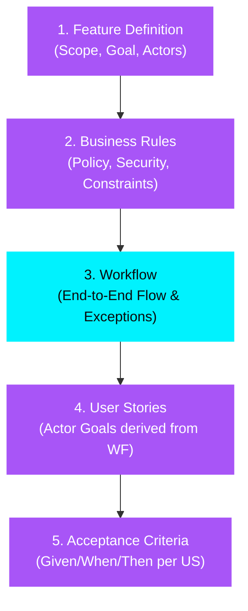

# Tối ưu hóa Thứ tự Các Section Phase 1 — BA Agent

> **Tác giả**: BA Agent Architectural Team  
> **Ngày tạo**: 2026-08-04  
> **Trạng thái**: vision (thứ tự FD → BR → WF → UC vẫn đúng trên runtime). Không đủ 8 section.  
> **Tiêu chuẩn áp dụng**: BABOK (Business Analysis Body of Knowledge), Agile Workflow-Driven Development, Design Thinking

---

## 1. Tổng quan Kiến trúc Thứ tự Phase 1

Nhằm tối ưu hóa luồng tương tác giữa User và BA Agent, đồng thời tận dụng khả năng tự động suy luận của hệ thống Multi-Agent, thứ tự thực hiện các Section trong **Phase 1 (Interactive Discussion)** được thiết lập theo phương án **Workflow-First (Workflow đứng trước User Stories)**.

---

## 2. Chi tiết 5 Bước Tuần tự & Mối phụ thuộc Dữ liệu (Data Dependency)

### 📌 Bước 1: Feature Definition (FD)
* **Mục tiêu**: Định hình phạm vi bài toán, lý do tồn tại và đối tượng tham gia.
* **Đầu ra (Outputs)**: `goal` (Business Value), `actors[]` (Primary & System actors), `scope_in[]`, `scope_out[]`.
* **Lý do đứng đầu**: Không thể thiết lập quy tắc hay luồng nghiệp vụ nếu chưa xác định rõ Ai tham gia và Feature giải quyết vấn đề gì.

---

### 📌 Bước 2: Business Rules (BR)
* **Mục tiêu**: Xây dựng "hành lang pháp lý/nghiệp vụ" chi phối toàn bộ tính năng.
* **Đầu ra (Outputs)**: Danh sách `business_rules[]` kèm `source`, `statement` (điều kiện kích hoạt + kết quả).
* **Lý do đứng thứ hai**: Business Rules mang tính độc lập với giao diện hay trình tự thao tác. Việc xác định BR trước giúp làm cơ sở để phát hiện các nhánh ngoại lệ (Exception flows) khi thiết kế Workflow ở bước tiếp theo.

---

### 📌 Bước 3: Workflow (WF) — *Trọng tâm thay đổi*
* **Mục tiêu**: Thiết lập luồng nghiệp vụ tổng thể từ đầu đến cuối (End-to-End E2E), bao gồm Main Flow, Exception Flows, và End States.
* **Đầu ra (Outputs)**: Bảng các bước công việc (Step | Actor | Action | BR Ref), các kịch bản ngoại lệ $E_1, E_2...$, sơ đồ Sequence Diagram.
* **Lý do đứng TRƯỚC User Stories**:
  1. **Bức tranh tổng thể (Big Picture)**: Thảo luận Workflow giúp User và Agent nhìn thấy toàn bộ hành trình trải nghiệm trước khi băm nhỏ thành từng tính năng lẻ.
  2. **Phát hiện kịch bản ngoại lệ sớm**: Đặt trong ngữ cảnh Workflow E2E kết hợp với Business Rules (ở Bước 2), Agent dễ dàng gợi ý các kịch bản lỗi (Timeout, Validation fail, Rejection...) mà User chưa nghĩ tới.
  3. **Cơ sở để tự động đề xuất User Stories**: Từ danh sách các bước trong Main Flow và Exception Flow, Agent có đủ dữ liệu để **gợi ý/sinh sẵn danh sách User Stories** ở Bước 4, giúp User không phải tự nghĩ từ đầu.

---

### 📌 Bước 4: User Stories (US)
* **Mục tiêu**: Băm nhỏ Workflow E2E thành các đơn vị yêu cầu theo góc nhìn của từng Actor.
* **Đầu ra (Outputs)**: Danh sách `user_stories[]` với định dạng `As a [Actor], I want [Workflow Action], so that [Business Benefit]`, liên kết tới `business_rule_ids` và `workflow_step_ids`.
* **Lý do đứng thứ tư**: Khi đã có Workflow làm khung sườn, mỗi bước trong Workflow hoặc mỗi nhóm bước liên quan sẽ tương ứng với $1$ User Story. Việc băm nhỏ từ Workflow giúp đảm bảo **100% đọ bao phủ (Coverage)** mà không bị trùng lặp hay sót scope.

---

### 📌 Bước 5: Acceptance Criteria (AC)
* **Mục tiêu**: Chi tiết hóa tiêu chí nghiệm thu cho từng User Story theo chuẩn `Given / When / Then`.
* **Đầu ra (Outputs)**: Danh sách `acceptance_criteria[]` gắn với từng `user_story_id`.
* **Lý do đứng cuối Phase 1**: AC cần tập hợp đầy đủ dữ liệu từ 4 bước trước:
  * **Given**: Lấy từ tiền điều kiện trong Workflow / Business Rules.
  * **When**: Hành động kích hoạt lấy từ User Story / Workflow Step.
  * **Then**: Kết quả mong đợi quan sát được từ Workflow End State / Business Rule output.

---

## 3. So sánh với Phương án Cũ (User Stories trước Workflow)

| Tiêu chí | Phương án Cũ (US ➔ AC ➔ WF) | Phương án Mới (WF ➔ US ➔ AC) |
| :--- | :--- | :--- |
| **Tư duy tiếp cận** | Rời rạc từng tính năng lẻ | Tổng thể E2E (System Thinking) |
| **Độ phủ kịch bản lỗi** | Dễ bỏ sót các nhánh Exception Flow | Phát hiện Exception sớm ngay khi dựng Workflow |
| **Trải nghiệm User** | User phải tự nghĩ từng User Story | Agent tự đề xuất User Stories dựa trên Workflow đã chốt |
| **Tránh làm lại (Rework)** | Thường xuyên phải sửa lại US khi vẽ Workflow thấy thiếu | US được sinh chuẩn xác từ Workflow nên hiếm khi phải sửa lại |

---

## 4. Tác động tới Hệ thống Multi-Agent & Dynamic Prompting

1. **Agent Workflow Facilitator (Bước 3)**:
   * Inject Context từ: `Feature Definition` (Actors, Scope) + `Business Rules`.
   * Prompting Focus: Đặt câu hỏi theo dạng *"Khi Actor A thực hiện X, nếu điều kiện BR-01 không thỏa mãn thì hệ thống xử lý ra sao?"*.
2. **Agent User Story Generator (Bước 4)**:
   * Chuyển từ chế độ "Hỏi User nhập US" sang chế độ **"Đề xuất US từ Workflow"**: Agent tự map mỗi `Main Flow Step` & `Exception Flow` thành các `User Story Draft`, User chỉ cần review & xác nhận.
3. **Validation & Completion Flags**:
   * Flag `US-F3` (Actor coverage) và `US-F4` (BR mapping) sẽ tự động `PASS` ngay từ đầu vì US được tạo ra trực tiếp từ Workflow đã chứa sẵn Actor và BR refs.
